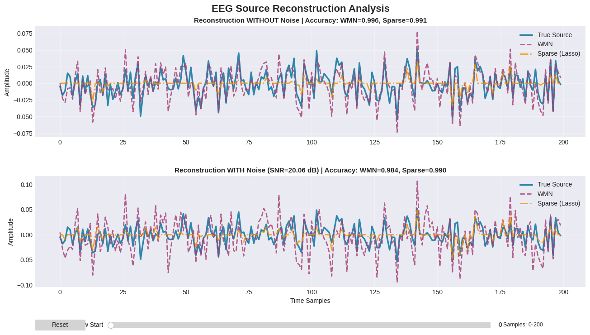

# EEG Source Reconstruction Analysis

## Overview

This project implements and compares two EEG source reconstruction methods for solving the inverse problem:

1. **Weighted Minimum Norm (WMN)** - L2 regularization approach
2. **Sparse Solution (Lasso)** - L1 regularization approach

The analysis evaluates both methods under clean and noisy conditions to assess their accuracy and robustness.

## Installation

Install the required dependencies:

```bash
pip install -r requirements.txt
```

## Required Data Files

The following data files must be present in the project directory:

- `Source.xlsx` - True source activity matrix (16 × 1000)
- `Leadfield.xlsx` - Forward model matrix (32 × 16)
- `EEG Data.xlsx` - Measured EEG signals (32 × 1000)
- `Noise.xlsx` - Additive noise matrix (32 × 1000)

## Usage

Execute the analysis script:

```bash
python code.py
```

The script will generate an interactive visualization comparing both reconstruction methods with and without noise.

## Methods

### Weighted Minimum Norm (WMN)

The WMN method employs L2 regularization to produce smooth, distributed source estimates:

$$\hat{S} = (G^TG + \lambda^2W^TW)^{-1}G^TY$$

where:
- $G$ is the leadfield matrix
- $Y$ is the measured EEG data
- $\lambda$ is the regularization parameter (λ = 0.1)
- $W$ is the weighting matrix

### Sparse Solution (Lasso)

The Lasso method uses L1 regularization to generate sparse source estimates:

$$\min \frac{1}{2}||Y - GS||^2 + \alpha||S||_1$$

where:
- $\alpha$ is the sparsity parameter (α = 0.001)

## Performance Metrics

The following metrics are used to evaluate reconstruction accuracy:

- **Pearson Correlation Coefficient (r)**: Measures linear relationship between true and estimated sources (range: 0 to 1, higher is better)
- **Root Mean Square Error (RMSE)**: Quantifies average magnitude of estimation errors (lower is better)
- **Signal-to-Noise Ratio (SNR)**: Expressed in decibels (dB)

## Results

The analysis produces an interactive visualization with two panels comparing source reconstruction performance with and without noise. The time-series display includes a slider control for temporal navigation.



*Figure: Comparison of WMN and Lasso source reconstruction methods under clean and noisy conditions.*

## Documentation

For detailed technical information, please refer to:

- [Project Report (PDF)](EEG_Project_Report-Team%233.pdf) - Complete technical documentation including theoretical background, methodology, results, and discussion

## Project Structure

```
task2/
├── code.py              # Main analysis script
├── requirements.txt       # Python dependencies
├── README.md             # Project documentation
├── Source.xlsx           # True source data
├── Leadfield.xlsx        # Forward model
├── EEG Data.xlsx         # Measured signals
├── Noise.xlsx            # Noise data
├── Result.png            # Analysis visualization
└── EEG_Project_Report-Team#3.pdf  # Technical report
```

## References

- [Codebase: Google Colab](https://colab.research.google.com/drive/1jhOW9lJmfEXvKg1y-8G1d-5OaUcpkTj1)

- [Interpreting magnetic fields of the brain: minimum norm estimates](https://doi.org/10.1007/BF02512476)
    
- [Regression shrinkage and selection via the lasso](https://doi.org/10.1111/j.2517-6161.1996.tb02080.x)

---

**Project**: Neuroengineering Task 2  
**Date**: November 5, 2025  
**Course**: Neuroengineering, Fall 2025
